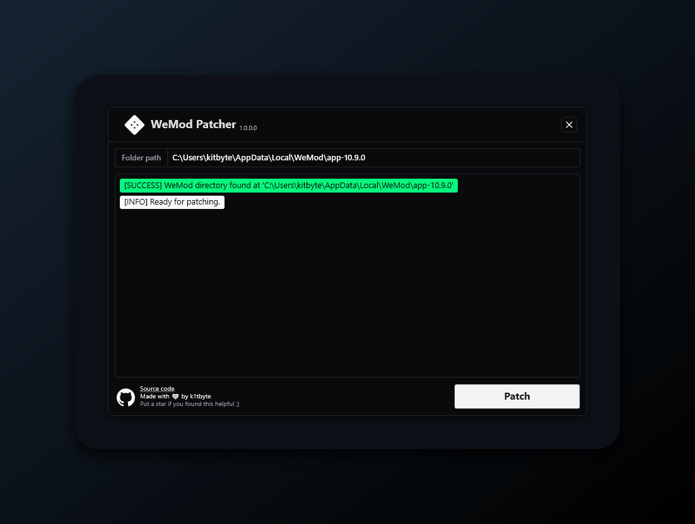
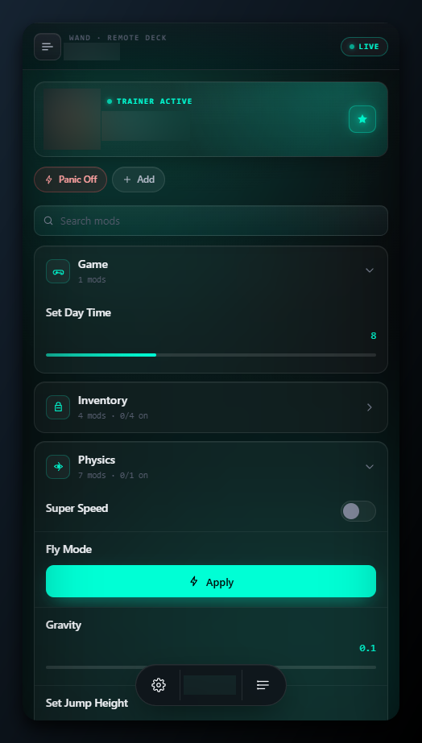

# WandEnhancer

> [!WARNING]
> **DMCA notice.** On 2026-11-10 GitHub received a DMCA takedown notice for several files of this repository. The files named in the notice were removed from the repository and its history, so the project does not build from this repository at the moment.

An open-source tool that extends the local client-side configuration of the Wand app and improves its UX.

> **This project has no official downloads and no official video tutorials.** GitHub releases contain notes only, never `.exe` files. Scammers use the project's name for fake tutorials and put malware or password stealers in the video descriptions. An executable or archive from a video, a website or a mirror did not come from this project, and we are not responsible for it. The only official source is this repository. Look-alike forks and accounts are not ours.

## Network and privacy

The patcher modifies files in the selected local Wand installation. By default it has no update check and no telemetry. Wand itself stays an online application. The optional remote web panel starts a LAN HTTP/WebSocket server and uses Wand API and CDN data, such as trainer translations and artwork.

## FAQ

**Why is there no `.exe` in GitHub Releases?** Unsigned and self-built patching tools were repeatedly reuploaded, mislabeled and flagged by third-party scanners, so the project stopped distributing prebuilt executables. Releases are notes-only on purpose.

**Can I use a binary built by someone else?** Treat it as untrusted. This repository cannot verify or support third-party builds.

## Screenshots

## License

Apache-2.0, see [LICENSE](LICENSE.md).

## Support

If you find this project useful, you can support its development with any option below.

---

> **Legal disclaimer:** This project is a third-party enhancement tool intended solely for educational, research and local interoperability purposes. It does not distribute any proprietary code or bypass server-side validations. All modifications are performed locally to customize the user's interface.
